<!-- Profile README · Gorisi Deepak Reddy
     Visuals are generated: edit the DATA block in scripts/build_assets.py, then run `python3 scripts/build_assets.py`. -->


 


I am a **Computer Science Engineering graduate** with an **MSc in Business Data Analytics**, based in Budapest. I build AI systems that connect models to real users, real workflows and outcomes that can be checked.

I do not treat a model as a source of truth. The model interprets intent, retrieves evidence and picks tools. Everything after that is deterministic: authoritative systems compute, typed tools enforce boundaries, safety policy gates actions, and verification decides whether the task actually succeeded.


| Where it shows up | What the principle looks like in practice |
|---|---|
| **Echo** | Observes, acts, verifies and updates state. A tool response is never taken as proof of success. |
| **Data Science Studio** | Real Python services compute every metric. The LLM only explains results that already exist. |
| **Gita.AI** | Retrieves from an embedding corpus of all **701 verses** instead of quoting from model memory. |
| **Risk and forecasting systems** | Model outputs become transparent decision support, not unexplained predictions. |

 

<a href="https://github.com/thedeepakreddy/Echo-mac"></a>

**[ECHO · Executive Computer Heuristic Operator](https://github.com/thedeepakreddy/Echo-mac)** is a working local-first autonomous agent runtime for macOS. It is an operating layer that combines perception, planning, tool execution, memory, verification, recovery and learning.

<b>Everything Echo can do</b>

 

| Area | Capabilities |
|---|---|
| **Perception** | Understands the desktop through screenshots, OCR and macOS accessibility APIs |
| **Action** | Operates apps with semantic controls, text targeting, vision and native system actions; re-resolves controls by meaning, not fixed coordinates |
| **Voice** | Streaming input and output with wake word, VAD, STT, TTS and barge-in interruption |
| **Verification** | Task postconditions confirm an action really happened; uncertain, partial, failed and verified operations are tracked separately |
| **Recovery** | Durable journals, checkpoints, heartbeats and provider/tool exchanges; interrupted tasks resume without blindly repeating uncertain side effects |
| **Replay** | Agent runs can be replayed to inspect why a task stopped |
| **Memory** | Project-scoped long-term memory with provenance, retention and deletion controls |
| **Learning** | Reusable skills and workflows learned from demonstrations, previewed before execution |
| **Brains** | Live switching between Claude, Gemini and local Ollama |
| **Delegation** | Durable agent clones and structured multi-agent missions |
| **Background work** | Research, screen monitoring, shadow coding and proactive assistance |
| **Reach** | Terminal, filesystem, displays, phone remotes, messaging, maps, media, calendars and system settings |
| **Local-first** | OCR, transcription, presence detection and model execution on device |


Echo records frontier-model trajectories: observations, tool calls, actions, results and verification state. I use those verified trajectories plus synthetic data to fine-tune a **Qwen 2.5-VL** policy with **GRPO**, distilling reliable computer use into an efficient local model without losing tool correctness, safety or task verification.

 

<a href="https://github.com/thedeepakreddy/Aira.AI-Website"></a>
<a href="https://github.com/thedeepakreddy/AskDeepakAI-DataScienceStudio"></a>
<a href="https://github.com/thedeepakreddy/Talktual"></a>
<a href="https://github.com/thedeepakreddy/Tata-Dransfer-by-AskDeepakAI"></a>
<a href="https://github.com/thedeepakreddy/Gita.AI"></a>
<a href="#analytics"></a>

| Project | Why it exists | Links |
|---|---|---|
| **Aira.AI** | One AI workspace across web, macOS and Windows. Provider keys stay server-side behind an authenticated gateway; file, shell, subagent and tool actions need approval. Typed, unit and integration tested. | [Repo](https://github.com/thedeepakreddy/Aira.AI-Website) |
| **Data Science Studio** | SQL, Python, ML and reporting for technical and non-technical users. Agentic reason-act-observe analysis, visual SQL builder, drift monitoring. No fabricated metrics. | [Repo](https://github.com/thedeepakreddy/AskDeepakAI-DataScienceStudio) · [Live](https://askdeepakai-datascientist.onrender.com/) |
| **Talktual** | Built from a real cross-cultural problem: two people without a shared language. QR handshake, push-to-talk, graceful fallback when speech services drop. | [Repo](https://github.com/thedeepakreddy/Talktual) · [Live](https://talktual.onrender.com/) |
| **Tata Dransfer** | Past the limits of free file-transfer services: 100GB+ direct-to-disk streaming, AES-GCM encrypted chat and files, audio, video and screen sharing. | [Repo](https://github.com/thedeepakreddy/Tata-Dransfer-by-AskDeepakAI) · [Live](https://tata-dransfer-by-askdeepakai-1.onrender.com/) |
| **Gita.AI** | Donated to ISKCON. Describe a personal problem and get semantically relevant verses, with source text kept separate from AI interpretation. Multilingual. | [Repo](https://github.com/thedeepakreddy/Gita.AI) |

 

| Project | Decision it supports | Methods |
|---|---|---|
| [Automated Risk Intelligence Analyst](https://github.com/thedeepakreddy/Automated-Risk-Intelligence-Analyst) | How exposed are we right now, and why? | Market and news ingestion, transparent systemic-risk scoring, explainable briefings |
| [Automated Market Intelligence Analyst](https://github.com/thedeepakreddy/Automated-Market-Intelligence-Analyst) | Where is the market heading? | Price, macro and sentiment features, XGBoost/LSTM ensemble, SHAP, time-series validation |
| [Prescriptive Churn Analytics](https://github.com/thedeepakreddy/Prescriptive-Churn-Analytics-in-E-commerce) | Who is worth retaining, at what cost? | Profit-optimized thresholds, business-cost-aware ML |
| [Enterprise Churn Optimization](https://github.com/thedeepakreddy/Enterprise-Churn-Optimization) | How much capital is at risk from attrition? | Gradient Boosting, SHAP, capital-at-risk analysis |
| [Last-Mile Delivery Analytics](https://github.com/thedeepakreddy/Last-Mile-Delivery-Analytics-Budapest) | Where are SLAs bleeding money? | PostgreSQL, SQL window functions, Tableau |
| [Inflation Forecasting Decision System](https://github.com/thedeepakreddy/Inflation-Forecasting-Decision-System) | What should we plan for next quarter? | Prophet, SARIMAX, XGBoost, backtesting, executive dashboards |
| [Trade Policy Decision Support](https://github.com/thedeepakreddy/AI-Driven-Trade-Policy-Impact-and-Decision-Support-System) | How do we source under a tariff shock? | Scenario modeling, economic impact, sourcing recommendations |
| [UNICEF Transaction Volume Analysis](https://github.com/thedeepakreddy/UNICEF-Transaction-Volume-Analysis) | Where is service delivery slipping? | Operational trends, anomaly detection |

 

 


I care about the full path from **problem framing to deployment and adoption**, not only model accuracy. A good system is useful to the person operating it, understandable to stakeholders, and honest about what it knows, did and verified.

 


